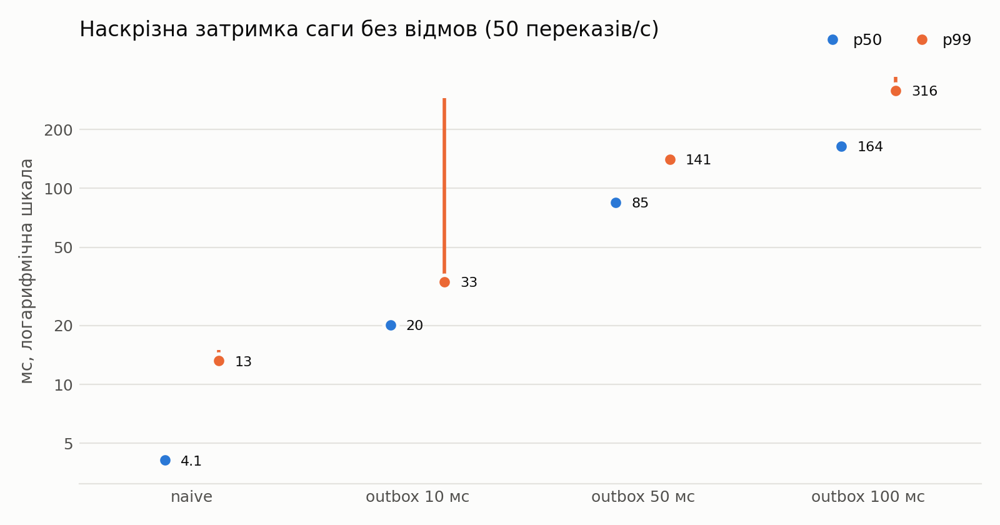
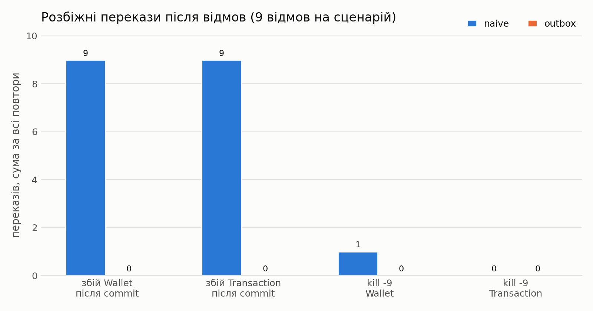

# Результати серії `series-20261112`

Згенеровано `experiments/aggregate.py` з `experiments/results/summary.csv`. Коміт(и): `255442f`. Значення — медіана за повторами, у дужках — мінімум–максимум; n — кількість повторів.

## 1. Затримка без відмов

| Конфігурація | n | Переказів/с | Сага p50, мс | Сага p95, мс | Сага p99, мс | HTTP p99, мс | Лаг outbox p99, мс | HTTP-помилки | Розбіжності |
|---|---|---|---|---|---|---|---|---|---|
| naive | 3 | 50 | 4.1 (3.9–4.3) | 7.6 (7.1–8.0) | 13.2 (12.8–15.0) | 9 (8–10) | — | 0 | 0 |
| outbox 10 мс | 3 | 50 | 20.1 (19.4–20.1) | 28.7 (28.2–29.5) | 33.4 (33.0–288.4) | 8 (7–517) | 16.6 (16.3–91.4) | 0 | 0 |
| outbox 50 мс | 3 | 50 | 84.9 (84.3–85.3) | 117.3 (111.3–119.6) | 140.9 (138.2–145.4) | 8 (7–9) | 61.2 (60.1–61.4) | 0 | 0 |
| outbox 100 мс | 3 | 50 | 164.4 (162.4–165.1) | 220.5 (219.5–221.8) | 316.2 (300.3–371.3) | 9 (8–10) | 111.7 (111.6–111.8) | 0 | 0 |
| naive, 200/с | 3 | 200 | 2.0 | 4.1 (3.9–6.0) | 9.7 (9.2–15.5) | 4 (3–5) | — | 0 | 0 |
| outbox 50 мс, 200/с | 3 | 200 | 84.4 (83.4–84.6) | 122.4 (120.1–125.1) | 162.2 (160.4–173.4) | 6 (5–113) | 55.9 (55.8–55.9) | 0 | 0 |

## 2. Коректність під час відмов

Кількості розбіжностей — **сума за всі повтори**, у дужках — значення кожного прогону. Медіана тут не підходить: при трьох повторах вона ховає поодиноку втрату (0, 1, 0 → 0). `consistency_rate`, HTTP-помилки й затримка — медіана (мін–макс).

| Сценарій | Стратегія | n | Відмов усього | Розбіжності | lost_request | lost_result_money_moved | consistency_rate | Сума збережена | HTTP-помилки | Сага p99, мс |
|---|---|---|---|---|---|---|---|---|---|---|
| збій Wallet після commit | naive | 3 | 9 | **9** (3 / 3 / 3) | 0 | 9 | 0.99948 | так | 0 | 6350 (6284–6367) |
| збій Wallet після commit | outbox | 3 | 9 | **0** (0 / 0 / 0) | 0 | 0 | 1.00000 | так | 0 | 6230 (6230–6273) |
| збій Transaction після commit | naive | 3 | 9 | **9** (3 / 3 / 3) | 9 | 0 | 0.99940 (0.99940–0.99941) | так | 721 (696–728) | 884 (799–1011) |
| збій Transaction після commit | outbox | 3 | 9 | **0** (0 / 0 / 0) | 0 | 0 | 1.00000 | так | 717 (713–729) | 951 (775–1069) |
| kill -9 Wallet | naive | 3 | 9 | **1** (0 / 1 / 0) | 0 | 1 | 1.00000 (0.99983–1.00000) | так | 0 | 6413 (6340–6462) |
| kill -9 Wallet | outbox | 3 | 9 | **0** (0 / 0 / 0) | 0 | 0 | 1.00000 | так | 0 | 6303 (6284–6398) |
| kill -9 Transaction | naive | 3 | 9 | **0** (0 / 0 / 0) | 0 | 0 | 1.00000 | так | 623 (587–638) | 1425 (1420–1825) |
| kill -9 Transaction | outbox | 3 | 9 | **0** (0 / 0 / 0) | 0 | 0 | 1.00000 | так | 642 (608–650) | 1750 (1400–1820) |

