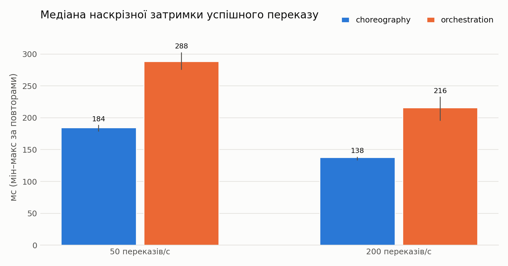
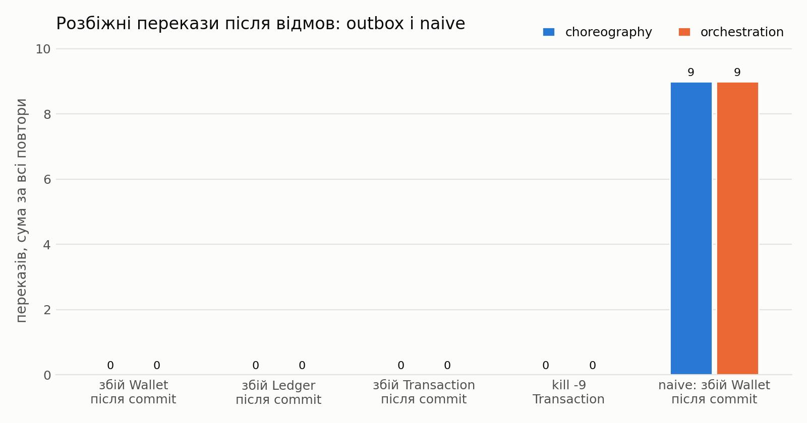

# Результати серії `series-20261124`: choreography проти orchestration

Згенеровано `experiments/aggregate_saga.py` з `experiments/results/summary-v2.csv`. Коміт(и): `667b4fe`. Доставка — outbox, якщо не вказано інше. Затримка — медіана за повторами (мінімум–максимум); n — кількість повторів.

## 1. Затримка саги і кількість повідомлень без відмов

| Координація | Навантаження | n | Успішні p50, мс | Успішні p99, мс | Компенсовані p50, мс | Компенсовані p99, мс | Повідомлень на переказ | HTTP p99, мс | Розбіжності (сума) |
|---|---|---|---|---|---|---|---|---|---|
| choreography | 50 переказів/с | 3 | 184.4 (178.7–188.9) | 275.3 (262.4–311.8) | 185.4 (179.2–186.9) | 302.4 (261.4–306.3) | 4.00 | 10 (8–14) | 0 |
| orchestration | 50 переказів/с | 3 | 288.2 (275.6–303.0) | 392.7 (375.7–407.7) | 291.0 (275.2–301.3) | 413.2 (389.1–468.2) | 6.00 (5.96–6.14) | 15 (9–25) | 0 |
| choreography | 200 переказів/с | 3 | 138.0 (133.2–139.0) | 278.8 (253.9–286.9) | 139.0 (132.2–139.6) | 267.3 (249.6–292.9) | 4.07 (4.00–4.07) | 30 (7–34) | 0 |
| orchestration | 200 переказів/с | 3 | 215.8 (195.3–233.0) | 365.5 (360.1–407.8) | 214.6 (196.3–230.4) | 372.0 (356.6–429.6) | 6.05 (6.02–6.08) | 10 (10–48) | 0 |

## 2. Коректність під час відмов

Кількості — сума за всі повтори, у дужках — значення кожного прогону.

| Сценарій | Координація | n | Відмов усього | Розбіжності | кошти заморожені | lost_request | lost_result_money_moved | lost_result_compensated | lost_result_rejected | порушення компенсації | Гроші збережено | HTTP-помилки | Сага p99, мс |
|---|---|---|---|---|---|---|---|---|---|---|---|---|---|
| збій Wallet після commit | choreography | 3 | 9 | 0 (0 / 0 / 0) | 0 | 0 | 0 | 0 | 0 | 0 | так | 0 | 6676 (6643–8827) |
| збій Wallet після commit | orchestration | 3 | 9 | 0 (0 / 0 / 0) | 0 | 0 | 0 | 0 | 0 | 0 | так | 0 | 6797 (6788–9867) |
| збій Ledger після commit | choreography | 3 | 9 | 0 (0 / 0 / 0) | 0 | 0 | 0 | 0 | 0 | 0 | так | 0 | 6230 (6128–6284) |
| збій Ledger після commit | orchestration | 3 | 9 | 0 (0 / 0 / 0) | 0 | 0 | 0 | 0 | 0 | 0 | так | 0 | 6375 (6332–6421) |
| збій Transaction після commit | choreography | 3 | 9 | 0 (0 / 0 / 0) | 0 | 0 | 0 | 0 | 0 | 0 | так | 714 (710–740) | 1023 (793–1055) |
| збій Transaction після commit | orchestration | 3 | 9 | 0 (0 / 0 / 0) | 0 | 0 | 0 | 0 | 0 | 0 | так | 756 (719–773) | 1782 (1458–5927) |
| kill -9 Transaction | choreography | 3 | 9 | 0 (0 / 0 / 0) | 0 | 0 | 0 | 0 | 0 | 0 | так | 638 (607–712) | 1398 (1266–1862) |
| kill -9 Transaction | orchestration | 3 | 9 | 0 (0 / 0 / 0) | 0 | 0 | 0 | 0 | 0 | 0 | так | 656 (618–696) | 2086 (1698–2100) |
| naive, збій Wallet після commit | choreography | 3 | 9 | 9 (3 / 3 / 3) | 5 | 0 | 4 | 0 | 0 | 0 | так | 0 | 6597 (6580–6643) |
| naive, збій Wallet після commit | orchestration | 3 | 9 | 9 (3 / 3 / 3) | 7 | 0 | 1 | 1 | 0 | 0 | так | 0 | 6806 (6804–6842) |

